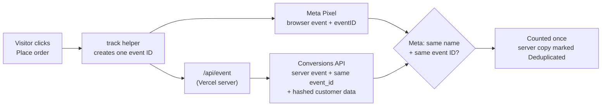
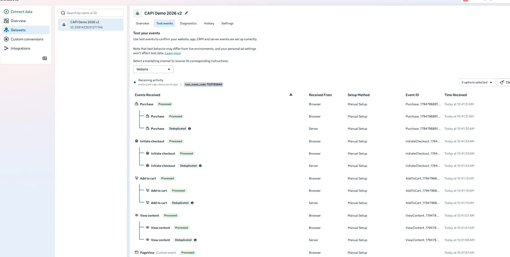

# Meta Pixel + Conversions API demo, with event deduplication

A small demo store that sends every conversion to Meta **twice**: once from the browser (Meta Pixel) and once from the server (Conversions API). Both copies share an event ID, so Meta counts each conversion **once**.

**Live demo:** https://meta-pixel-capi-demo.vercel.app (a fake store; nothing is charged)

Built by Markson de Villa, a Meta media buyer, to show the tracking side of the job: getting accurate conversion data into Meta, not just running campaigns.

## Why this matters for ad performance

- **Browser-only tracking misses conversions.** Ad blockers, privacy browsers (like Brave) and some networks block the Meta Pixel. When that happens, Meta never hears about the sale and optimizes on incomplete data.
- **Sending from the server fills the gap**, because the server isn't affected by what's installed in the visitor's browser.
- **Sending from both without deduplication double-counts** purchases and inflates reported ROAS. The shared event ID prevents that.

## How it works

| Event | Browser (Pixel) | Server (CAPI) | Deduplicated |
|---|---|---|---|
| PageView | Yes | No (kept browser-only) | n/a |
| ViewContent | Yes | Yes | Yes |
| AddToCart | Yes | Yes | Yes |
| InitiateCheckout | Yes | Yes | Yes |
| Purchase | Yes | Yes, with hashed email, phone and first name | Yes |

Every event sends `value: 24` and `currency: USD`, which is what Meta uses to report purchase value and ROAS.

## Proof: deduplication in Events Manager

Each event arrives from **Browser** and **Server** with the same event ID, and Meta marks the server copy **Deduplicated**:

## Files

| File | What it does |
|---|---|
| `index.html` | The demo store (product → cart → checkout → thank you), the Meta Pixel, and a `track()` helper that sends each event to both the pixel and the server with one shared event ID |
| `api/event.js` | A Vercel serverless function that normalizes and SHA-256 hashes customer data, adds the browser cookies `_fbp`/`_fbc`, the visitor's IP and user agent, and sends the event to the Conversions API |

## Privacy and security

- Email, phone and first name are **normalized (trimmed, lowercased, digits only for phone) and SHA-256 hashed on the server** before being sent to Meta. They are never sent raw from the browser.
- The access token, pixel ID and test event code are stored as **Vercel environment variables**, never in the code.
- Meta's automatic button-click tracking is turned off (`autoConfig: false`), so the dataset only receives the events defined here.

## Run your own copy

1. Fork this repo and import it into Vercel.
2. Replace the pixel ID in `index.html` with your own dataset's ID.
3. In Vercel → Settings → Environment Variables, add `META_PIXEL_ID`, `META_ACCESS_TOKEN` (from Events Manager → Settings → Conversions API) and, while testing, `META_TEST_EVENT_CODE` from the Test Events tab.
4. Test from a browser without ad blockers and check Events Manager → Test events.

## What I learned

- **One ID everywhere.** In my first attempt, I mixed up IDs (at one point I used an account ID instead of the pixel ID), so events didn't land where I was looking. Now I always confirm the dataset ID in Business Settings before wiring anything.
- **Test event codes are per session.** Server events only show in Test Events when the server sends the code from the session that is open right now. An old code means Meta still receives the events but hides them from Test Events.
- **The server function has to live in `api/`.** In my first attempt the updated file was uploaded to the wrong folder, so the live site kept running old code. Pushing with Git from my own folder fixed that.
- **Testing needs a clean browser.** My home network and Brave block the pixel, so browser events didn't show up until I tested elsewhere.
- **Deduplication needs both the same event name and the same event ID.** Different IDs, or a missing ID on either side, means double counting.
- **Event Match Quality depends on the data, not just the setup.** Fake test emails can't match real Meta accounts, so test scores are lower than a live store would get.

## Tools

Meta Pixel · Meta Conversions API · Events Manager · Vercel (serverless functions) · GitHub · JavaScript
